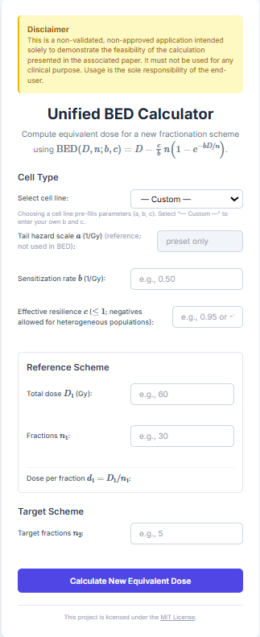

# Unified BED Calculator

Unified BED Calculator calculates biologically effective dose (BED), equivalent dose in 2 Gy fractions (EQD2), and the total dose required for an isoeffective schedule with a specified number of fractions. It uses the therapeutic form of the Resilience–Depletion (RD) survival law.

[Open the calculator](https://joliverapps.github.io/Unified-BED-Calculator/).

For research and educational use. The application has not been validated for clinical decision-making.

## Use the calculator

1. Choose a parameter preset or enter tissue parameters manually.
2. Select **Classical** to enter α/β and Dq, or **RD Params** to enter r and s.
3. Enter the reference total dose **D₁** and number of fractions **n₁**.
4. Enter the target number of fractions **n₂**.
5. Read the reference BED and EQD2, then the target total dose **D₂**, dose per fraction, and BED. Results update when all required inputs are complete; **Calculate Equivalent Dose** also runs the calculation.

Use **Show Calculation Details** to view the reference BED, the inversion quantity K, and the Lambert-W value. Selecting a preset clears the schedule fields. Editing a tissue parameter clears the preset selection.



## Parameters and units

| Input | Meaning | Units and allowed values |
| --- | --- | --- |
| r | Initial resilience, or effective resilience for an inverted response | Dimensionless; r < 1 |
| s | Sensitization rate governing resilience depletion with dose | Gy⁻¹; s ≥ 0 |
| α/β | Ratio of the strict low-dose linear and quadratic coefficients | Gy; finite and nonzero in Classical mode |
| Dq | Dose-axis intercept of the extrapolated high-dose survival tail | Gy; finite and nonzero in Classical mode |
| D₁ | Reference total dose | Gy; positive |
| n₁, n₂ | Reference and target fraction counts | Positive integers |

Each schedule consists of equal fractions, with dose per fraction d = D/n. Comparisons use the same tissue parameters and assume acute delivery of each fraction with restoration of resilience between fractions. The calculator does not include time-dependent recovery, repopulation, or dose-rate corrections.

The parameter choices describe three responses:

| Response | RD inputs | Classical inputs |
| --- | --- | --- |
| Standard shoulder | 0 < r < 1 and s > 0 | Positive α/β and positive Dq |
| Single-hit linear response | r = 0; also available through the s = 0 linear limit | Enter through RD Params |
| Inverted shoulder | r < 0 and s > 0 | Negative α/β and negative Dq |

For an inverted shoulder, r is an effective descriptor of population response rather than an individual survival probability. Enter both signed Classical values explicitly. At a linear response, BED and EQD2 equal the physical dose, and the isoeffective target total dose equals D₁ for any target fraction count.

The killing-efficiency scale k cancels from these comparisons, so k and D₀ are not required inputs. Values too close to r = 1 are rejected because BED is normalized by α = k(1−r).

## Results

| Result | Meaning |
| --- | --- |
| Reference BED | RD biological effect of the reference schedule, normalized by its initial hazard slope |
| EQD2 | Total dose in 2 Gy fractions with the same RD effect |
| EQD2 fraction count | EQD2 divided by 2 Gy; reported as a real number |
| New total D₂ | Dose giving the reference BED in n₂ equal fractions |
| Dose/Fx | D₂/n₂ |
| BED Output | Biological effect shared by the reference and target schedules |

Doses and BED values are displayed to two decimal places. Calculation details are displayed to six decimal places. See [Mathematical model and calculations](MATHEMATICS.md) for the equations, signed parameter conversion, limiting cases, and numerical implementation.

## Run a local copy

Clone the repository or download and extract its files:

```text
git clone https://github.com/JoliverApps/Unified-BED-Calculator.git
```

Open `index.html` in a modern browser. The page loads styling, fonts, equation rendering, and preset data from online resources, so an internet connection is needed for the complete interface. The preset script is loaded from the hosted `datasrc.js` URL specified in `index.html`.

For a local HTTP preview with Python installed, open a terminal in the repository folder and run:

```text
python -m http.server 8000 --bind 127.0.0.1
```

Open [http://127.0.0.1:8000](http://127.0.0.1:8000). Keep the terminal running and refresh the browser after saving edits. Press Ctrl+C in the terminal to stop the preview.

In Visual Studio, open the cloned folder with **File → Open → Folder**. Use **Git → Pull** to download updates and **Git Changes → Commit**, followed by **Push**, to upload saved changes.

## Troubleshooting

| Problem | Action |
| --- | --- |
| A linear response cannot be entered in Classical mode | Select **RD Params** and enter r = 0 or s = 0. |
| The Classical pair gives an invalid solution | Use α/β and Dq with the same sign and check that the converted r and s satisfy the displayed constraints. |
| A singularity is reported near r = 1 | Check the entered parameters; the initial-slope BED normalization vanishes at r = 1. |
| No parameter presets appear | Check the internet connection and the preset-script URL in `index.html`. |
| Very small converted parameters become zero | Conversion fields retain six decimal places; use RD Params to enter small values directly. |
| No result appears | Complete all required fields and resolve the validation message shown in the calculator. |

## Reference and related tool

Oliveira JM. Resilience–depletion hypothesis: Unifying BED from conventional to ablative radiotherapy. *Medical Physics*. 2026;53:e70490. [doi:10.1002/mp.70490](https://doi.org/10.1002/mp.70490).

[RD EQD2 Optimizer](https://github.com/JoliverApps/RD_Dq_Optimizer) estimates Dq by minimizing the dispersion of RD-derived EQD2 across a selected prescriptions set.

## License

The application code is distributed under the [MIT License](LICENSE).
